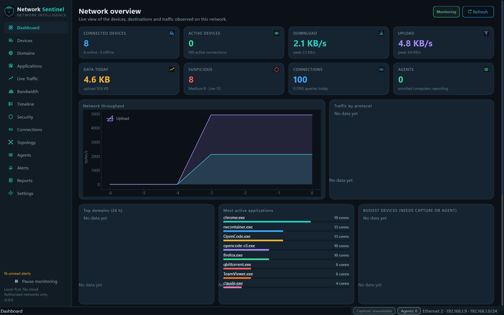
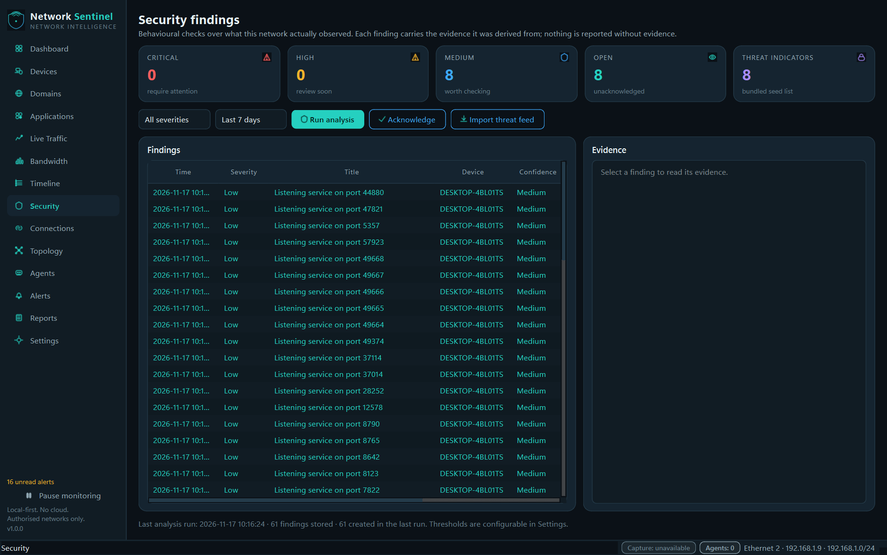
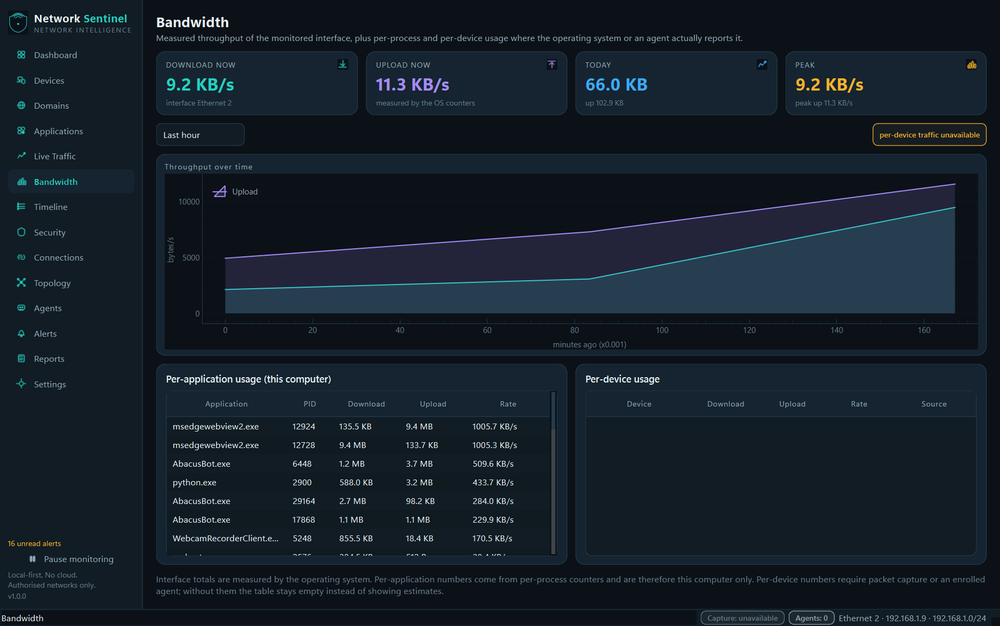
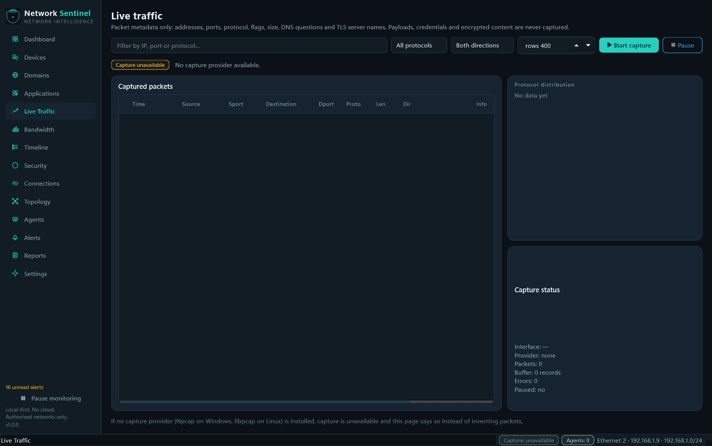

# Network Sentinel

Professional desktop application for Windows 11 and Linux that provides comprehensive visibility into a user's local network, device intelligence, traffic analysis, and security monitoring.



## Main Features

1. **Live Network Monitoring**: Real-time throughput graphs, interface selection, packet statistics.
2. **Automatic Device Discovery**: ARP table sweeps, mDNS, DHCP passive observation.
3. **Device Identification**: MAC OUI manufacturer lookup, reverse-DNS hostname resolution, OS and device type classification from collected evidence.
4. **Website & Domain Activity**: DNS query monitoring, categorization, TLS server name indication (SNI) tracking.
5. **Application Connection Monitoring**: Per-process socket attribution on managed computers via OS socket tables (`GetExtendedTcpTable` on Windows, `/proc` on Linux).
6. **Bandwidth Statistics**: Measured interface throughput, per-application rates, per-device traffic attribution.
7. **Security Detection**: Behavioural analysis (port scan bursts, connection failure storms, unexpected listeners, new untrusted devices) and threat-intelligence matching (bundled seed list + custom feed import).
8. **Activity Timelines**: Chronological feed of events, DNS queries, connections, and findings per device.
9. **Alerts & Notifications**: Threshold-based alarms with desktop notifications.
10. **Reports**: Self-contained PDF, HTML, and JSON reports generated from local database telemetry with automated credential redaction.
11. **Optional Companion Agent**: Securely report sockets and byte counters from remote computers administered by you.

---

## Screenshots

| Dashboard | Devices | Topology |
|:---:|:---:|:---:|
|  |  |  |

| Security | Bandwidth | Live Traffic |
|:---:|:---:|:---:|
|  |  |  |

---

## Privacy & Local-First Architecture

* **100% Local**: All telemetry is stored in a local SQLite database (`%LOCALAPPDATA%\NetworkSentinel`). Nothing is sent to any cloud service.
* **Metadata-Only Capture**: Packet capture inspects headers, ports, protocol flags, DNS questions, and TLS server names. Payload contents, credentials, cookies, tokens, and browser history are never captured, stored, or displayed.
* **Visible Agent Status**: The optional agent runs explicitly when started, requires a signed enrollment token, and can be unstopped or uninstalled instantly.
* **No Guesses**: If an application or website cannot be resolved, it is reported as `Unattributed` or `Encrypted`, never guessed.

---

## Installation & Running from Source

### Prerequisites
* Python 3.12 or newer.
* (Optional) Npcap (Windows) or libpcap (Linux) for raw packet capture.

### Setup
```bash
git clone https://github.com/unupunct/Network-Sentinel.git
cd Network-Sentinel
pip install -r requirements.txt  # or pip install PySide6 pyqtgraph scapy psutil fastapi uvicorn reportlab
python -m networksentinel.app.main
```

### Self-Test
To verify core services headlessly without launching the GUI:
```bash
python -m networksentinel.app.main --selftest
```

---

## License & Author

Developed as a professional utility for authorized local network monitoring.
