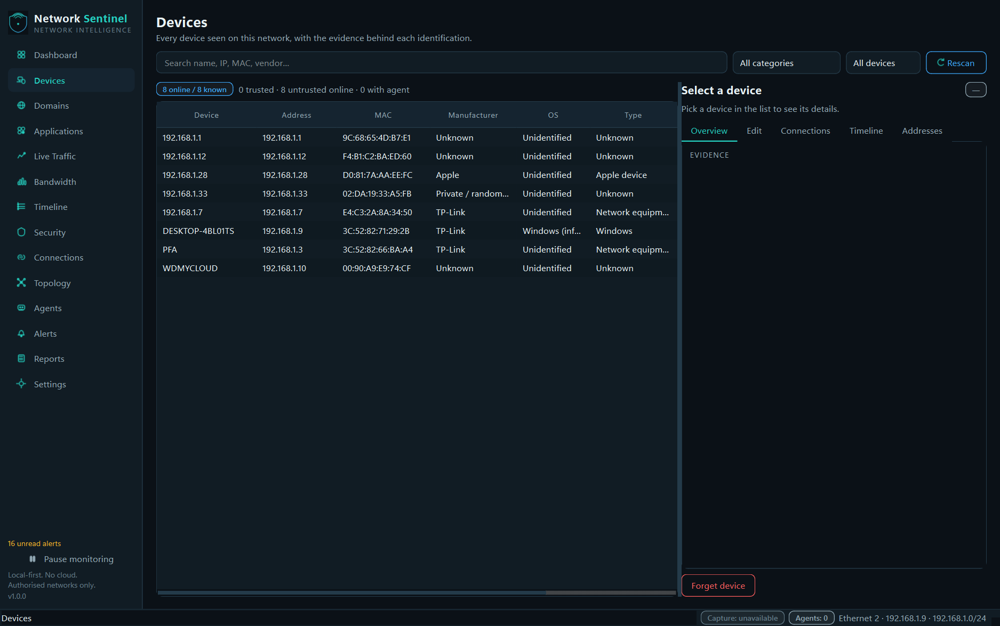
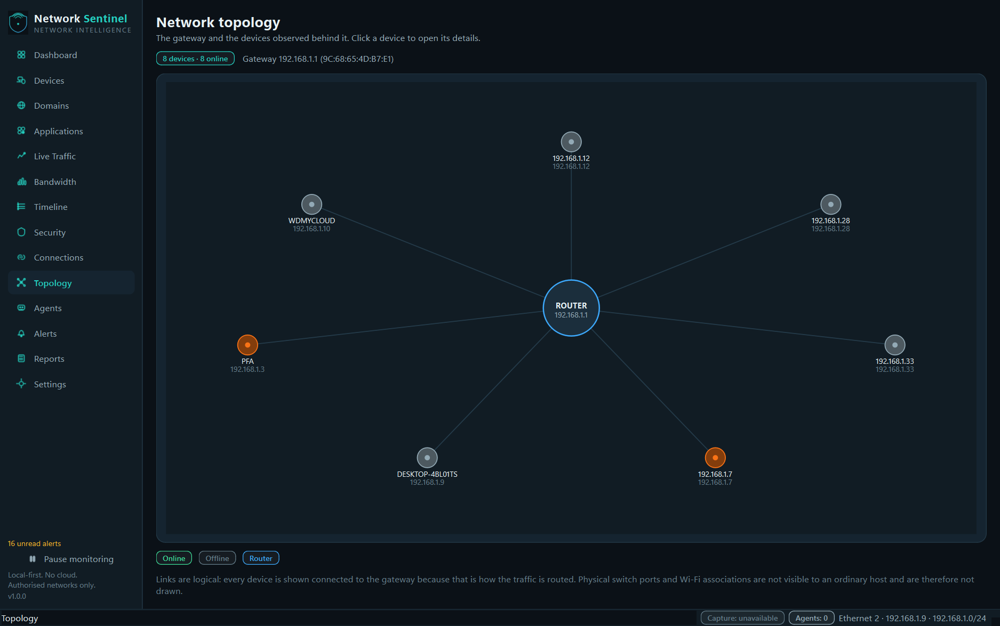
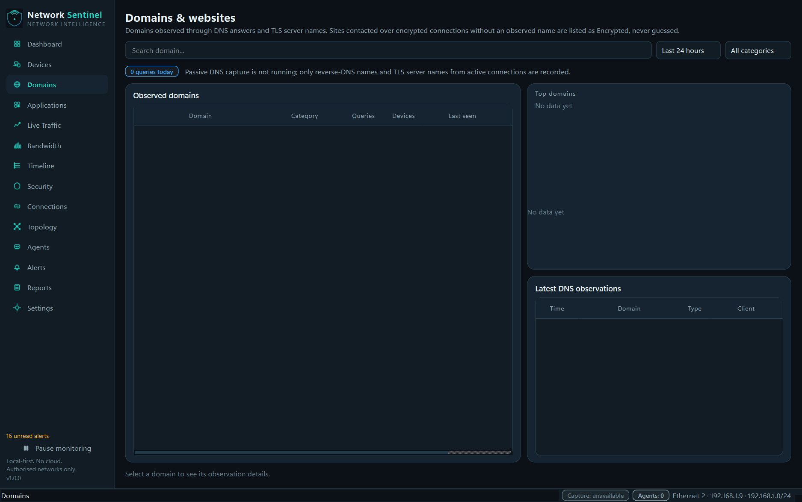
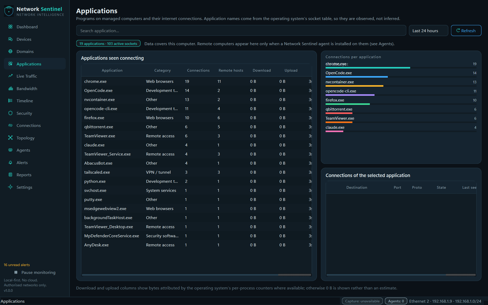
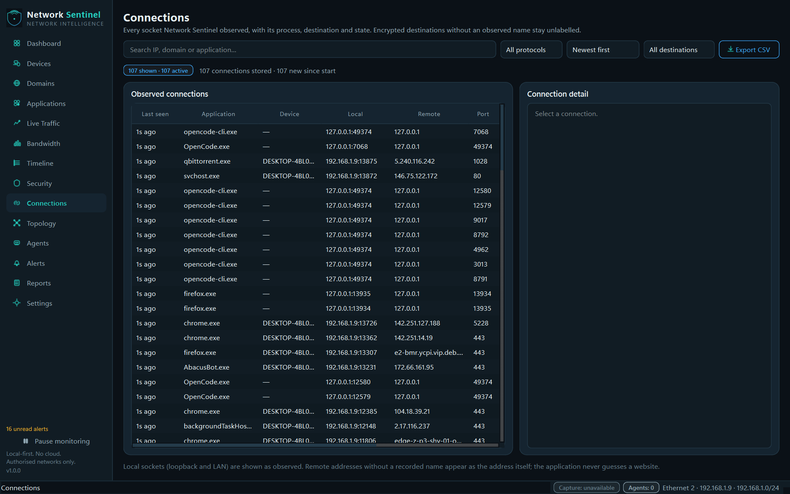
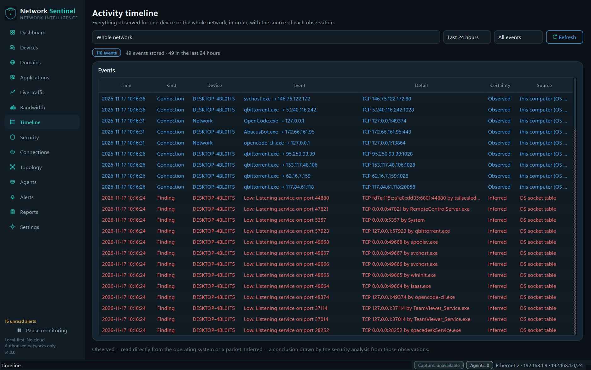
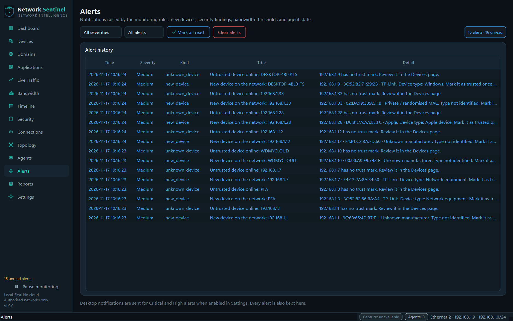
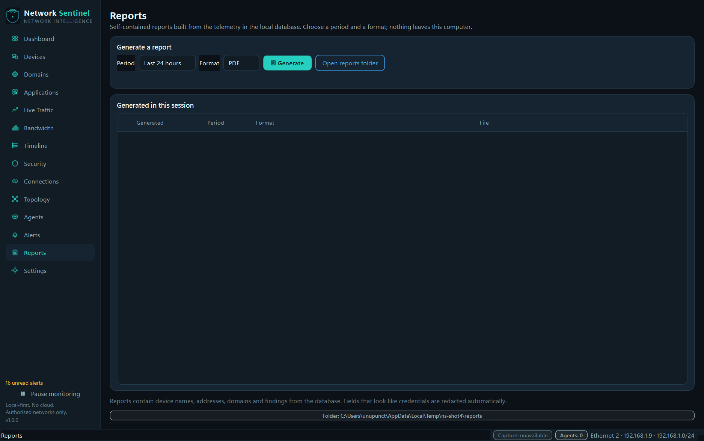
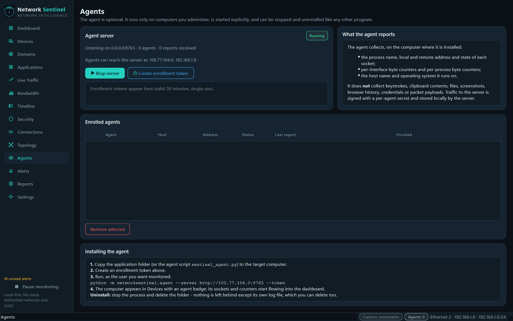
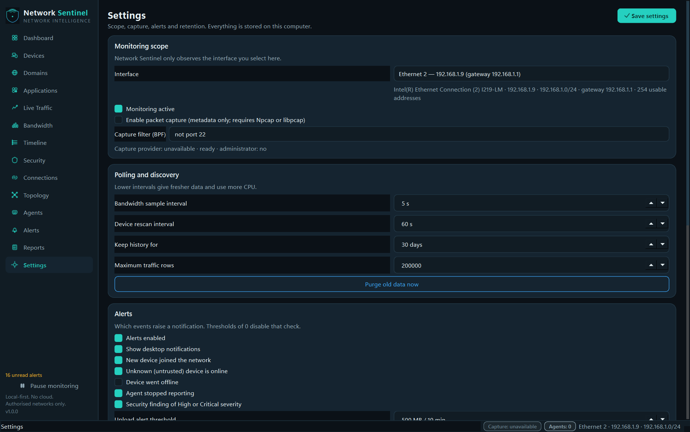

# Network Sentinel

**Professional desktop application for Windows 11 and Linux that provides comprehensive visibility into a user's local network, device intelligence, traffic analysis, and security monitoring.**


## About

**Network Sentinel** is a defensive network monitoring application for people who need to know what is happening on their own network — and why.

It is built for authorised use: your own LAN, your own devices, or computers you administer on behalf of an organisation. It is a *visibility* tool: it observes, records and explains. It does not block, throttle, delete, or interfere with anything, and it never phones home.

### What it does

- **Live network monitoring** — real-time throughput graphs, interface selection, packet and interface statistics.
- **Automatic device discovery** — ARP table sweeps, mDNS and DHCP passive observation, with device intelligence (MAC OUI manufacturer lookup, reverse-DNS hostname resolution, OS and device-type classification from collected evidence).
- **Website and domain activity** — DNS query monitoring, domain categorisation, TLS server-name-indication (SNI) tracking.
- **Application connection monitoring** — per-process socket attribution on managed computers via the OS socket tables (`GetExtendedTcpTable` on Windows, `/proc` on Linux).
- **Bandwidth statistics** — measured interface throughput, per-application rates, per-device traffic attribution.
- **Security detection** — behavioural analysis (port-scan bursts, connection failure storms, unexpected listeners, new untrusted devices) plus threat-intelligence matching (bundled seed list + custom feed import).
- **Activity timelines, alerts and notifications** — threshold-based alarms with desktop notifications.
- **Reports** — self-contained PDF, HTML and JSON reports generated from local database telemetry, with automated credential redaction.

### Privacy and local-first architecture

- **100% local**: all telemetry is stored in a local SQLite database (`%LOCALAPPDATA%\NetworkSentinel`). Nothing is sent to any cloud service.
- **Metadata-only capture**: packet capture inspects headers, ports, protocol flags, DNS questions and TLS SNI. Payload contents, credentials, cookies, tokens and browser history are never captured, stored or displayed.
- **Visible agent status**: the optional agent runs explicitly when started, requires a signed enrolment token, and can be unstopped or uninstalled instantly.
- **No guesses**: if an application or website cannot be resolved, it is reported as `Unattributed` or `Encrypted`, never guessed.

---

## Main Features

1. **Live Network Monitoring**: Real-time throughput graphs, interface selection, packet statistics.
2. **Automatic Device Discovery**: ARP table sweeps, mDNS, DHCP passive observation.
3. **Device Identification**: MAC OUI manufacturer lookup, reverse-DNS hostname resolution, OS and device type classification from collected evidence.
4. **Website & Domain Activity**: DNS query monitoring, categorisation, TLS server name indication (SNI) tracking.
5. **Application Connection Monitoring**: Per-process socket attribution on managed computers via OS socket tables (`GetExtendedTcpTable` on Windows, `/proc` on Linux).
6. **Bandwidth Statistics**: Measured interface throughput, per-application rates, per-device traffic attribution.
7. **Security Detection**: Behavioural analysis (port scan bursts, connection failure storms, unexpected listeners, new untrusted devices) and threat-intelligence matching (bundled seed list + custom feed import).
8. **Activity Timelines**: Chronological feed of events, DNS queries, connections, and findings per device.
9. **Alerts & Notifications**: Threshold-based alarms with desktop notifications.
10. **Reports**: Self-contained PDF, HTML, and JSON reports generated from local database telemetry with automated credential redaction.
11. **Optional Companion Agent**: Securely report sockets and byte counters from remote computers administered by you.

---

## Screenshots

| Dashboard | Devices | Topology |
|:---:|:---:|:---:|
|  |  |  |

| Security | Bandwidth | Live Traffic |
|:---:|:---:|:---:|
|  |  |  |

| Domains | Applications | Connections |
|:---:|:---:|:---:|
|  |  |  |

| Timeline | Alerts | Reports |
|:---:|:---:|:---:|
|  |  |  |

| Agents | Settings |
|:---:|:---:|
|  |  |

> Full set: 01-dashboard, 02-devices, 03-domains, 04-applications, 05-live-traffic, 06-bandwidth, 07-timeline, 08-security, 09-connections, 10-topology, 11-agents, 12-alerts, 13-reports, 14-settings.

---

## Privacy & Local-First Architecture

* **100% Local**: All telemetry is stored in a local SQLite database (`%LOCALAPPDATA%\NetworkSentinel`). Nothing is sent to any cloud service.
* **Metadata-Only Capture**: Packet capture inspects headers, ports, protocol flags, DNS questions, and TLS server names. Payload contents, credentials, cookies, tokens, and browser history are never captured, stored, or displayed.
* **Visible Agent Status**: The optional agent runs explicitly when started, requires a signed enrollment token, and can be unstopped or uninstalled instantly.
* **No Guesses**: If an application or website cannot be resolved, it is reported as `Unattributed` or `Encrypted`, never guessed.

---

## Installation

### Windows 10/11 (recommended)

Download the installer from the [latest release](https://github.com/unupunct/Network-Sentinel/releases/latest):

- **NetworkSentinel_Setup.exe** — installer (per-user by default, no admin rights needed; Start Menu shortcut, optional desktop shortcut, upgrade-safe, uninstaller with optional data removal).
- **NetworkSentinel.exe** — portable single-file app (no installation required).

Windows 10/11 x64. No Python runtime required.

### Linux

From source — see [Installation & Running from Source](#installation--running-from-source).

Data is stored in `%LOCALAPPDATA%\NetworkSentinel` on Windows and `~/.local/share/NetworkSentinel` (or the platform data dir) on Linux.

### From Source

#### Prerequisites

* Python 3.12 or newer.
* (Optional) Npcap (Windows) or libpcap (Linux) for raw packet capture.

#### Setup

```bash
git clone https://github.com/unupunct/Network-Sentinel.git
cd Network-Sentinel
pip install -r requirements.txt
python -m networksentinel.app.main
```

#### Self-Test

To verify core services headlessly without launching the GUI:

```bash
python -m networksentinel.app.main --selftest
```

---

## Releases

| Version | Date | Notes |
|:---:|:---:|:---|
| [1.0.0](https://github.com/unupunct/Network-Sentinel/releases/tag/v1.0.0) | 2026-11-18 | First public release. |

See [CHANGELOG](release/CHANGELOG.txt) for release notes.

---

## License & Author

Developed as a professional utility for authorized local network monitoring.

MIT — see [LICENSE](LICENSE).
